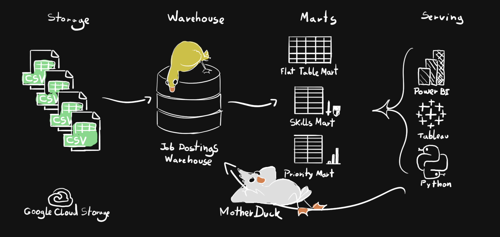
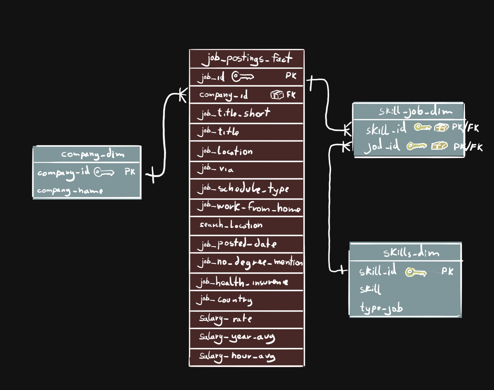
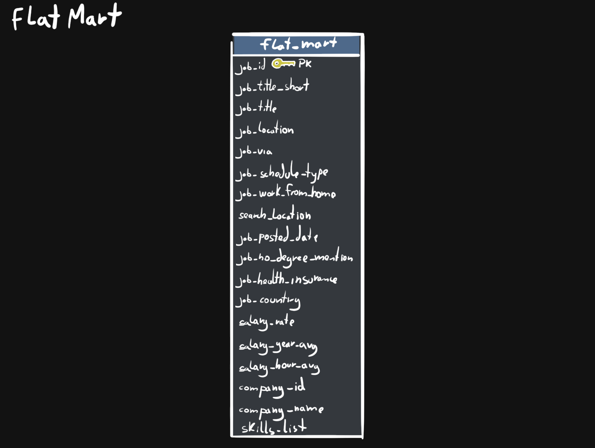
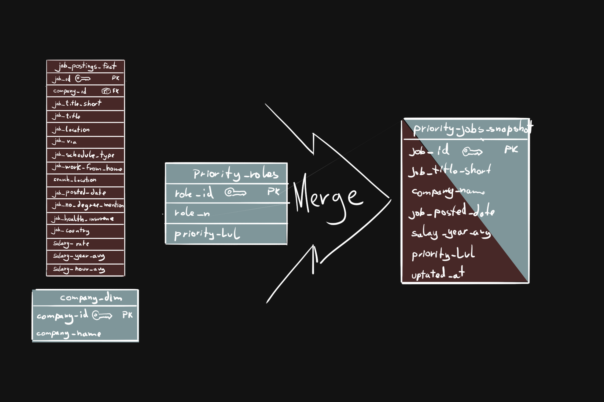

# 🏗️ Pipeline de Dados: Data Warehouse e Data Marts

Projeto de Engenharia de Dados com **DuckDB, MotherDuck e SQL**. Retirei os dados do arquivos CSV no Google Cloud Storage. Vão para um Data Warehouse como tabelas de consulta



## 🧾 Resumo executivo (para recrutadores)
 - ✅ Escopo <p>
 Desenvolvimento de pipeline ETL completo, desde arquivos CSV brutos até um Data Warehouse em star schema e Data Marts analíticos
 - ✅ Modelagem de dados <p>
 Star schema com fact, dimensional e tabelas de associação para many-to-many.
 - ✅ Desenvolvimento ETL <p>
 Processos de extração, transformação e carga, com operações idempotentes e verificações de qualidade dos dados
 - ✅ Arquitetura dos Data Marts <p>
 Data Marts especializados (flat, habilidades e prioridades), com métricas aditivas e padrões de atualização incremental

## 🎯Objetivo

Organizar dados para responder:

- Quais as habilidades mais procuradas?
- Quais empresas contratando?
- Variação salário/cargo/local

🏋️‍♀️Desafio: Criar uma fonte única e confiável de informações (Data Warehouse) para análises. Data Marts especializados com dados pré-agregados.

🥇Solução: Um pipeline ETL completo que extrai CSV's da nuvem, organiza os dados em um Data Warehouse com star schema e cria Data Marts especializados para consultas, análise da demanda por habilidades e acompanhamento de cargos prioritários.

## Tecnologias

- 🐤**DuckDB:** execução das consultas SQL
- 🦆**MotherDuck:** banco de dados na nuvem
- 🛢**SQL:** criar, carregar e transformar os dados
- ☁**Google Cloud Storage:** fonte dos CSV's
- 👨‍💻**VS Code:** escrita dos scripts
- 🐱‍👤**Git e GitHub:** controle de versões

## Arquivos do projeto

```text
first_pipeline/
├── 00_create_dw_master_build.sql   # Scripts pra pipeline
├── 01_tables_data_warehouse.sql    # tabelas pro Data Warehouse
├── 02_load_schema_dw.sql           # carrega os dados dos CSVs
├── 03_flat_table.sql               # tabela desnormalizada
├── 06_create_priority_mart.sql     # estrutura mart de prioridades
├── 07_update_priority_mart.sql     # sincronização das vagas
├── 08_validating_priority_mart.sql # validação de prioridades
├── integrity_check.sql             # Verificação de integridade
├── sample.sql                      # consulta de exemplo
└── README.md                       # documentação
```
# 🏗️ Arquitetura do Pipeline


A pipeline transforma os CSVs do Google Cloud Storage num star schema normalizado para data warehouse, então transforma em data marts especializadas. BI tools (Excel, Power BI, Tableau, Python) usadas tanto para a warehouse quanto as marts.

Data Warehouse

A warehouse usa o star schema company_dim, skills_dim, job_postings_fact, and skills_job_dim tables.


## Como funciona

1. **Origem:** arquivos CSV armazenados do Google Cloud Storage
2. **Data Warehouse:** dados organizados em tabelas fact e dimensional
3. **Flat Table:** informações para consultas mais simples
4. **Priority Mart:** vagas selecionadas por regras de prioridade
5. **Validação:** verificar resultados e integridade dos dados

## Data Warehouse


O modelo contém quatro tabelas principais:

| Tabela | Função |
|---|---|
| `company_dim` | Informações das empresas |
| `skills_dim` | Informações das habilidades |
| `job_postings_fact` | Informações das vagas |
| `skill_job_dim` | Relação entre vagas e habilidades |
**Objetivo**: Star schema servir como fonte única para consultas analíticas
**Granularidade**: Uma linha por postagem de vaga (job_postings_fact)

**Arquivos:** `01_tables_data_warehouse.sql` e `02_load_schema_dw.sql`

## Flat Mart
Tabela desnormalizada com todas as dimensões para consulta




**Arquivo:** `03_flat_table.sql`

## Priority Mart

Vagas de cargos com nível de prioridade em cada um



- `06_create_priority_mart.sql`: schema, regras e a tabela c/ vagas prioritárias
- `07_update_priority_mart.sql`: sincroniza os registros com `MERGE`
- `08_validating_priority_mart.sql`: validação dos resultados

O `MERGE` **insere**, **atualiza** e **exclui** registros conforme as regras de prioridade. A sincronização consulta as vagas atuais; não é uma captura incremental por data ou CDC.

## Qualidade dos dados

- `integrity_check.sql`: checa referências inválidas entre tabela
- `08_validating_priority_mart.sql`: verifica dados do mart de prioridades
- `sample.sql`: consulta de exemplo

## Como executar

No **Git Bash**, abra a pasta do projeto e conecte-se ao MotherDuck:

```bash
cd .../first_pipeline
duckdb "md:dw_marts"
```

No prompt do DuckDB (`D`), execute o script principal:

```text
.read 00_create_dw_master_build.sql
```

Para executar um script isolado(alguns dependem de outros):

```text
.read 03_flat_table.sql
```

**Atenção:** o script principal precisa usar os nomes reais dos arquivos acima. Executá-lo pode recriar ou modificar tabelas. Alguns scripts dependem de outros para serem executados.

## ♟Conhecimentos aplicados

### Desenvolvimento de Pipelines ETL

- **Extração:** Leitura direta dos CSV's com a extensão `httpfs` do DuckDB
- **Transformação:** Normalização dos dados, converção (`CAST`, `DATE_TRUNC`) e filtros de qualidade
- **Carga:** Criação idempotente das tabelas `DROP TABLE IF EXISTS`
- **Atualizações incrementais:** Uso de `MERGE` para inserir, atualizar e excluir registros (`INSERT`, `UPDATE`, `DELETE`) em um único comando
- **Orquestração:** Uso de script SQL principal (`00_create_dw_master_build.sql`) para executar o pipeline

### Modelagem Dimensional

- **Star schema:** Fact table (`job_postings_fact`) ligadas com as tabelas dimensão (`company_dim`, `skills_dim`)
- **Tabelas de associação:** Tratamento de relacionamento many to many (`skill_job_dim`, `bridge_company_location`, `bridge_job_title`)
- **Granularidade:** habilidade + mês; empresa + cargo + localização + mês
- **Métricas aditivas:** Contagens e somas que podem ser agregadas novamente em diferentes níveis
- **Surrogate Keys:** Identificadores sequenciais (CTEs e *self-joins*), apenas pro Data Mart opcional de empresas

### Técnicas Avançadas de SQL

- **Comandos DDL:** `CREATE TABLE`, `DROP TABLE` e `CREATE SCHEMA` para criar e gerenciar estruturas do banco.
- **Comandos DML:** `INSERT INTO ... SELECT` com mapeamento explícito das colunas dos arquivos CSV.
- **Operações MERGE:** Atualizações incrementais com `MERGE INTO`(`WHEN MATCHED`, `WHEN NOT MATCHED`, `WHEN NOT MATCHED BY SOURCE`) para inserir, atualizar e excluir registros.
- **CTEs:** para transformações complexas e conversão de indicadores boleanos
- **Funções de data:** `DATE_TRUNC('month')` e `EXTRACT(quarter)` para trabalhar com intervalos de tempo
- **Funções de texto:** `STRING_AGG` para concatenar valores e `REPLACE` para substituir textos
- **Lógica condicional:** Uso de `CASE WHEN` para agregar indicadores como trabalho remoto, plano de saúde e diploma

### Qualidade de Dados e Boas Práticas de Produção

- **Idempotência:** Scripts que podem ser executados repetidamente sem provocar efeitos indesejados
- **Validação dos dados:** Consultas de verificação em cada etapa do pipeline para garantir a integridade dos dados
- **Definição de tipos:** Uso adequado de `VARCHAR`, `INTEGER`, `DOUBLE`, `BOOLEAN` e `TIMESTAMP`
- **Organização dos schemas:** Separação lógica dos Data Marts em schemas específicos (`flat_mart`, `skills_mart`, `priority_mart`, `company_mart`)
- **Tratamento de erros:** Execução estruturada dos scripts, com mensagens claras de erro e acompanhamento do progresso
